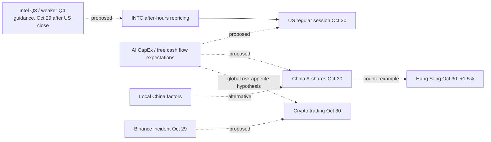

# Detecting international market shocks — design v0.1

Date: **2026-10-30**. Case: [US AI tech, China and crypto, 2026-10-30](../data/cases/ai-tech-multimarket-2026-10-30.json). Event discovery produces **candidates**, not established causal conclusions.

## Why one dramatic article is not one event

A single headline may make at least four different kinds of statement:
- **Measurable observation:** Nasdaq Composite closed −2.9% on 2026-10-30.
- **Underlying disclosure:** Intel published weaker Q4 guidance despite Q3 revenue growth and positive operating margin.
- **Causal interpretation:** AI infrastructure investment expectations were revised and sold across global stocks.
- **Universal generalization:** "Every company is unprofitable" — contradicted by Intel's own positive operating income and not supported for the entire sector.

Each is stored as a separate time-stamped signal or claim, with source confidence, geography and applicable market **session**. Do not label everything "crash" or treat emotional language as a measurement.

## Ingestion chain

```
News / social comment / public filing / price series / exchange notices
       ↓ (independent timestamp, provenance and license)
Entity recognition (ticker → issuer; market → country/venue; metric → units)
       ↓
Candidate news events + independent price and fundamental measurements
       ↓
Deduplication (syndication is not three independent reports)
       ↓
Anomaly detector (asset-class threshold + historical normalized surprise)
       ↓
Cross-market candidate cluster (correct local session windows)
       ↓
Evidence/contradiction retrieval, competing causal hypotheses
       ↓
Human/verified analytical review → graph edge status
       ↓
Scenario assumptions, exposure paths and future resolution
```

No automatically inferred causal claims from the headlines alone.

## Detection classes and illustrative thresholds (heuristics, not calibrated)

| Asset family | Rule to flag candidate | Additional checks |
|---|---|---|
| Listed stock | daily close-to-close change ≤ −8% or ≥ +8% | 20/60 day realized volatility, news timestamp, splits/corporate actions, unusual volume |
| Broad equity index | daily change ≤ −2.5% or ≥ +2.5% | breadth, equal-weight index, interest rates, sector concentration |
| Sector index | daily change ≤ −4% or ≥ +4% | representative sector exposure and control-sector returns |
| Crypto | rolling **24h** change ≤ −5% or ≥ +5% | liquidation spikes, exchange security, spot/perpetual differences and UTC windows |

In a calibrated release, replace fixed thresholds with `|return − expected_return| / sigma_60d` and quantiles computed on correctly adjusted total-return histories, *plus* robust-MAD treatment of extreme outliers. A return outside a fixed threshold is only **an unusual movement candidate**, not evidence of manipulation, bubble or contagion.

### Multimarket detection
- Generate a cluster only when at least two index alerts occur in ≥2 regions within a compatible 36h wall-clock envelope (heuristic).
- Show local exchange **close time and timezone**. Asia markets on Oct 30 may react to US after-hours guidance Oct 29, before the US Oct 30 regular session: do not draw `US Oct30 closing prices → China Oct30 open`.
- Include exceptions (Hang Seng **rose**, ChiNext **fell**) as visible counterexamples.
- For fundamental announcements, align news release, expectations, initial after-hours repricing, next local opening, next regular session close.
- Build separate **risk-off** and **sector-specific AI expectations** hypotheses; include China's domestic demand, PC weakness/memory cost, central bank rates and Binance as nonexclusive drivers.

## Specific Oct 30, 2026 findings
Observed and source-attributed:
- Intel **~−28.6%** closing move according to Reuters (roughly −30% when rounded / intraday); **Q3 revenues +21% YoY, GAAP operating margin 15.3%** according to the primary Intel release.
- Nasdaq Composite **−2.9%** (AP closing recap). Reuters discusses **>$2T** *potential* October loss in Nasdaq-100 constituents' market cap — **not** cash withdrawn from exchanges.
- Mainland Shanghai Composite **−1.44%**, Shenzhen Component **−2.73%**, ChiNext **−4.13%** (RTHK). Hong Kong Hang Seng **+1.5%** and Hang Seng Tech **+0.3%** — evidence against "all China's exchanges collapsed".
- Bitcoin/other crypto fell amid contemporaneous **Binance breach** reports (Reuters): no attribution solely to AI until event study.

## Candidate causal DAG (temporal reality)



The arrows marked proposed should remain `hypothesized_to_affect` until a peer-reviewed identification method supports them.

## Test questions / source-of-truth

| Falsifiable question | Dataset |
|---|---|
| Was Intel down more than expected after its own guidance vs peers? | Company Q3 release, analyst consensus **before** release, intraday licensed quotes for Intel/peers |
| Were high AI CapEx equities hit more than other technology stocks? | Company CapEx/FCF revisions, adjusted returns and sector-matched controls |
| Did mainland China and HK really move together? | Exchange EOD indices: Shanghai, Shenzhen, ChiNext, HSI / HS Tech (respect session times) |
| Were crypto losses caused by AI fear or Binance? | Binance incident timeline, BTC/ETH/BNB returns and liquidations in aligned UTC windows |
| Was it a valuation reset or deterioration in current profits? | Balance sheets, operating income, FCF, forward guidance, price/earnings and market cap |

Use official first-party reports, SEC structured company facts and licensed OHLC/volume sources; GDELT may supply multilingual news *leads*, not stock market ground truth. Do not quietly equate reported changes with independently verified exchange prices.

## MVP implementation and status

- `data/examples/market-selloff-observations-2026-10-30.json` — 6 reported, time-stamped stock/index movements and explicit narrative qualifications.
- `tools/detect_market_events.mjs` — pure deterministic anomaly candidates; category-specific threshold; no cause assignment; cross-region clustering and positive counterexamples.
- `tests/detect-market-events.test.mjs` — input source verification, timing separation, cluster behavior and Hong Kong divergence.
- `data/cases/ai-tech-multimarket-2026-10-30.json` — editorial, evidence-linked graph for the case, including conflicting causes.
- `prototype/research-board.html` — 4th case selectable in the existing graph viewer.

Run from repo root:

```bash
node tools/detect_market_events.mjs data/examples/market-selloff-observations-2026-10-30.json
node --test tests/detect-market-events.test.mjs
```

**Not implemented:** periodic live exchange quotes, corporate actions, volume/volatility baseline, NLP extraction from arbitrary new narratives, automated causal identification, notification subscriptions or production deployment. A deterministic threshold on a hand-curated file is a **prototype**, not a live signal engine.
